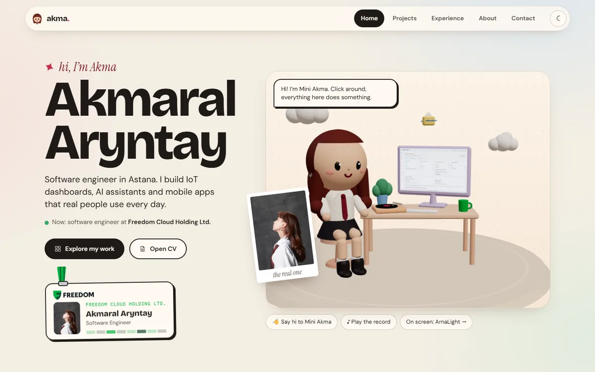

<div align="center">

# akma.

**Akmaral Aryntay — software engineer from Astana.**<br>
IoT dashboards, AI assistants and mobile apps that real people use.

<picture>
  <source media="(prefers-color-scheme: dark)" srcset="docs/preview-dark.webp">
  
</picture>

`Next.js 16` · `React 19` · `TypeScript` · `React Three Fiber` · `Web Audio`

</div>

---

## Inside

A one-page portfolio with a small 3D world. Mini Akma, a clay version of me, sits at a desk where the monitor shows my real projects.

- **Mini Akma.** Built from 3D primitives in the browser. She follows your cursor, waves when clicked, and the record player on her desk actually plays.
- **Real screens.** Every project opens with screenshots from the live product, its public demo, or a local run. Each image is labelled with its source.
- **Experience as an orbit.** Freedom Cloud Holding Ltd. as a small planet. The products I work on circle it as satellites.
- **Photo wall.** Real photos as polaroids you can drag around.
- **Light and dark.** Follows your system theme, with a switch in the menu.

## Projects

| | What | Stack |
|---|---|---|
| **ArnaSmart** | IoT metering + the ArnaAI assistant on a local LLM | Angular · NestJS · MongoDB · Ollama |
| **Digital Jailay** | Livestock tracking: GPS collars, pastures, heatmap, Telegram alerts | Angular · NestJS · Flutter |
| **Reporter** | Ops console: alert routing, AI chat logs, reports | Angular · Express · WebSocket |
| **ArnaLight** | Smart street lighting (team product) | Angular · NestJS · Modbus |
| **MyRoom** | One 360° photo → a 3D room | FastAPI · HorizonNet · R3F |
| **Attendance Control** | QR + PIN roll call for Astana IT University | .NET MAUI · PostgreSQL |
| **Agriprom** | Agritech catalogue and dashboards | Next.js · Recharts |

## Run it

```bash
npm install
npm run dev        # http://127.0.0.1:3000
```

```bash
npm run build      # static site in out/
npm run preview    # http://127.0.0.1:4173
npm test           # Playwright, desktop + mobile
```

Deploys to Vercel as is. Set `NEXT_PUBLIC_SITE_URL` to your domain for correct Open Graph links.

## Map

```
app/          layout, page, styles
components/   sections, project sheet, nav, guide
  three/      Mini Akma, desk scene, orbit scene
  demos/      MyRoom 3D, attendance flow, ArnaAI explainer
data/         all texts and project facts
public/       screenshots, photos, CV
```

---

<div align="center">

**[GitHub](https://github.com/arynttai)** · **[LinkedIn](https://www.linkedin.com/in/aryntay/)** · **[Telegram](https://t.me/sindugahvon)** · arynttai@gmail.com

<sub>Photos are real. Product screenshots belong to their owners. Mini Akma is a 3D sketch.</sub>

</div>
